<p align="center">
  <a href="https://vnmoorthy.github.io/phoenixastar/">
    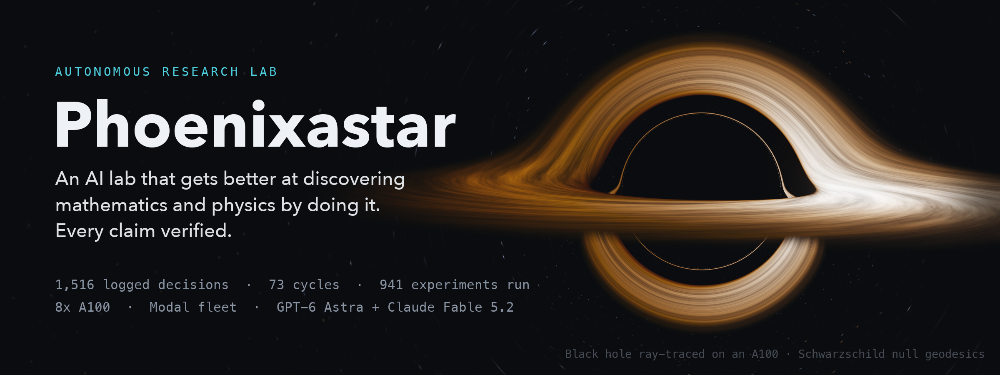
  </a>
</p>

<h1 align="center">Phoenixastar</h1>

<p align="center"><b>An AI lab that gets better at discovering mathematics by doing it.</b></p>

<p align="center">
  <a href="LICENSE"></a>
  
  
  <a href="https://vnmoorthy.github.io/phoenixastar/"></a>
</p>

<p align="center">
  <a href="https://vnmoorthy.github.io/phoenixastar/"><b>Replay demo</b></a> ·
  <a href="docs/ARCHITECTURE.md">Architecture</a> ·
  <a href="docs/RESULTS.md">Results</a> ·
  <a href="docs/REPRODUCE.md">Reproduce</a> ·
  <a href="docs/SPONSORS.md">Sponsors</a>
</p>

---

Phoenixastar is an autonomous research lab that attacks open record problems in mathematics (EinsteinArena) and
open questions in theoretical physics (periodic orbits of the three-body problem; the black hole information problem),
where every claim can be checked by an exact verifier. A loop of agents watches live searches on 8 GPUs and 124 CPU
cores, reads its own memory and the literature, proposes the next experiment with a falsifiable prediction, and
moves compute accordingly. Every decision, source, prediction and outcome is logged, so the whole run can be
replayed and audited.


<table>
  <tr>
    <td width="33%"></td>
    <td width="33%">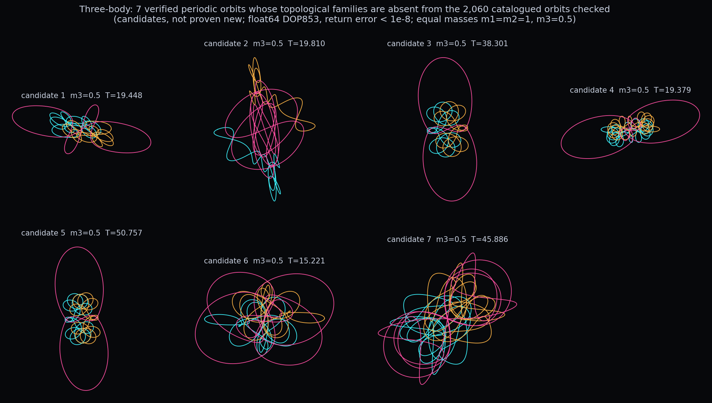</td>
    <td width="33%">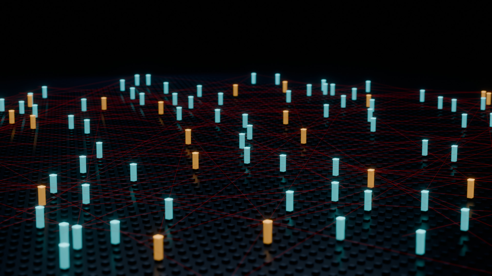</td>
  </tr>
  <tr>
    <td><sub><b>Black hole information.</b> Event Horizon, rendered from the measured data: each disk ring is one evaporation step of the N = 26 Page curve (artwork from data).</sub></td>
    <td><sub><b>Celestial mechanics.</b> 17 verified periodic three-body orbits in 16 families absent from the 2,060 catalogued orbits we checked (candidates).</sub></td>
    <td><sub><b>Mathematics.</b> A live SAT model of no-three-in-line on the 75 x 75 grid; red threads are lines that still hold three points.</sub></td>
  </tr>
</table>

## The product

A live mission control for the lab: every number comes from the running system, and every moving image is a
real-time 3D scene built from real data (drag to rotate, pinch to zoom, tap to inspect). Live replay:
[vnmoorthy.github.io/phoenixastar](https://vnmoorthy.github.io/phoenixastar/).

| | |
|---|---|
| 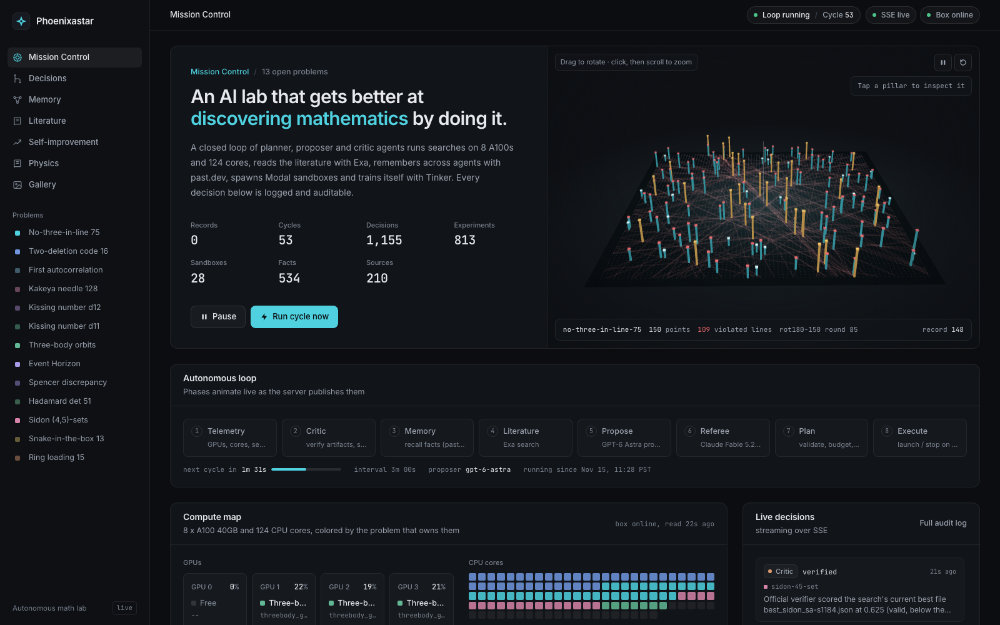 | 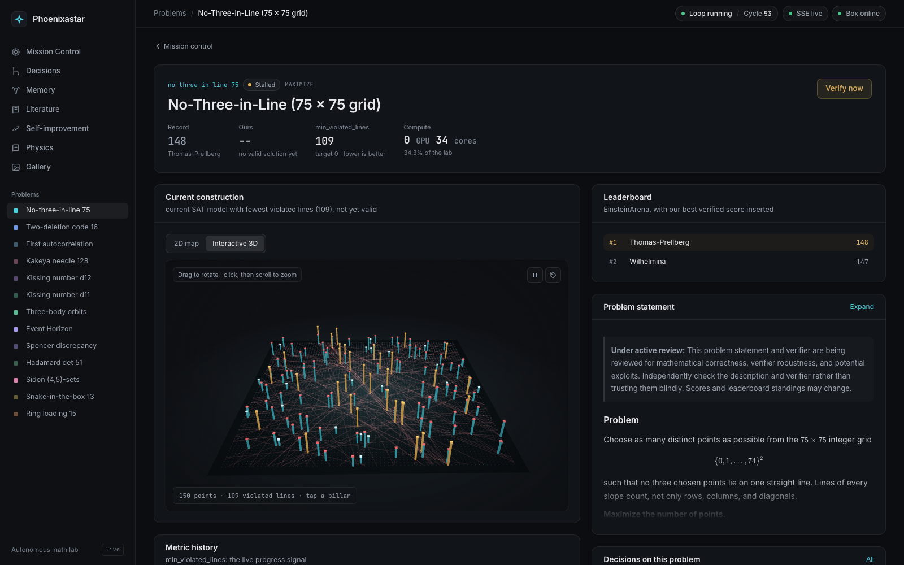 |
| **Mission Control.** Loop status and phase, the 8 x A100 + 124-core + Modal compute map, the problem portfolio and the live decision feed. | **A problem page.** The current construction as an interactive 3D lattice, the leaderboard, live metric history, running strategies and the official verifier one click away. |
| 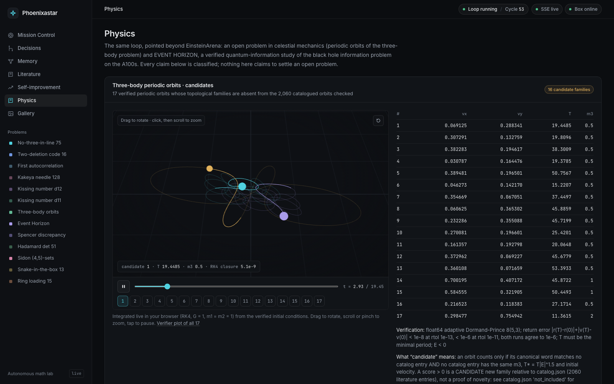 | 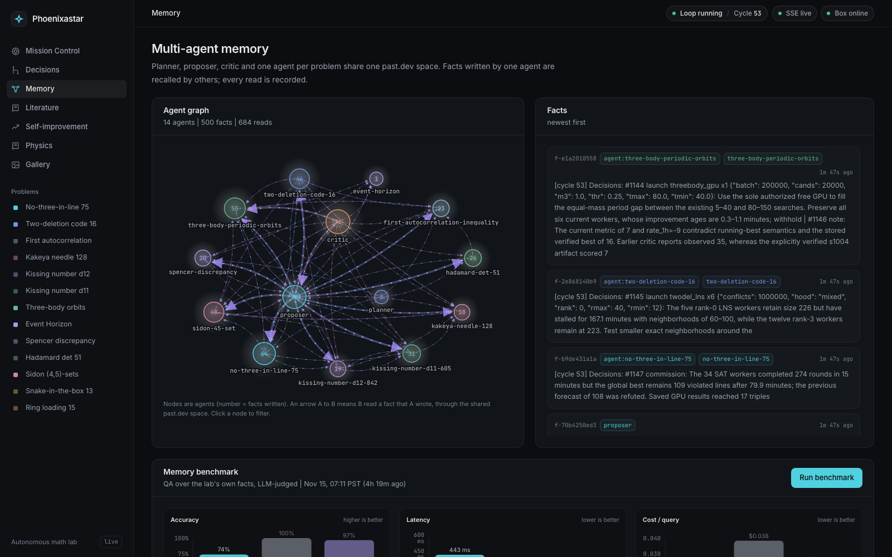 |
| **Physics.** The three-body candidates integrated live in the browser (play, scrub, pick any of 17) next to their verified initial conditions. | **Memory.** Which agent read which agent's facts through past.dev, and the benchmark against markdown and RAG. |
| 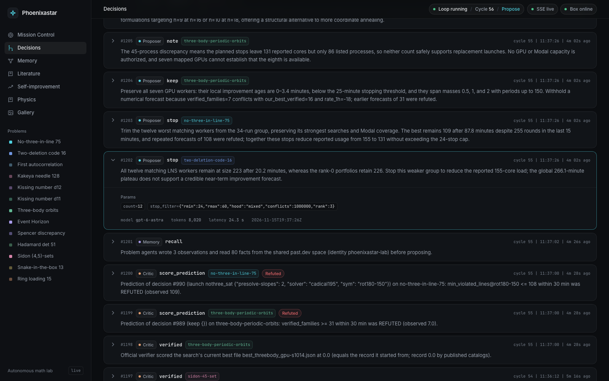 | 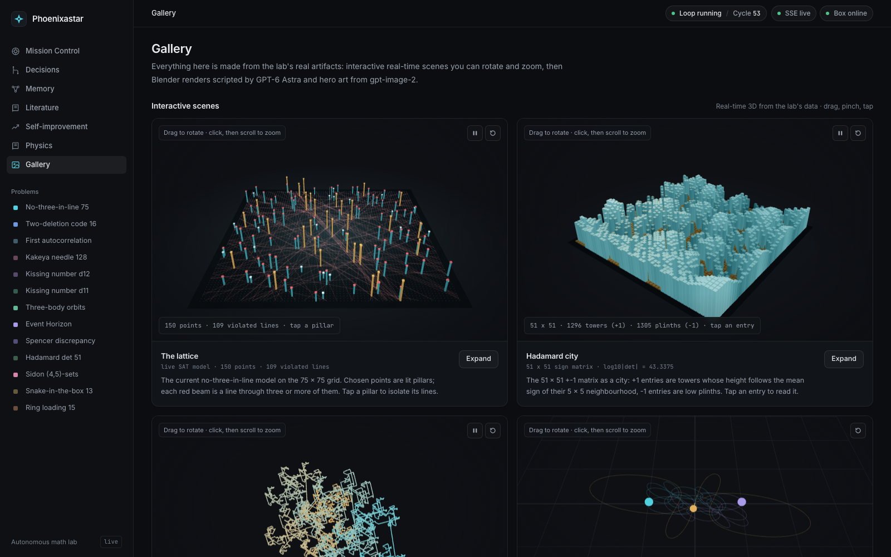 |
| **Decisions.** Every move with its rationale, parameters, model, tokens and latency; the critic marks predictions confirmed or refuted against what actually happened. | **Gallery.** Interactive 3D scenes (lattice, Hadamard city, snake, three-body orbits) and Blender renders, all from the run's real data. |

## What it does

| | |
|---|---|
| **Runs a research loop on its own** | `telemetry -> critic -> memory -> literature -> propose -> referee -> plan -> execute`, one cycle every 180 s, in a background thread of the server. |
| **Trusts nothing it did not verify** | Every candidate is re-scored by the official [EinsteinArena](#sponsors-and-credits) verifier in a subprocess. A record is declared only if `evaluate()` beats the leaderboard by `minImprovement`. |
| **Makes predictions, then scores them** | Each proposal states a metric, an expected value and a horizon. The critic later marks it `confirmed` or `refuted` and writes the lesson to memory. |
| **Remembers across agents** | Planner, proposer, critic and one agent per problem share one past.dev memory space, and the lab benchmarks it against markdown and RAG on its own facts. |
| **Reads before it tries again** | When a problem stalls, the loop asks Exa for literature and attaches the sources to the decisions that used them. |
| **Lets models write code safely** | LLM-written search programs run in parallel Modal sandboxes with no network and no secrets; their output is verified locally. |
| **Trains itself** | A Tinker RL run fine-tunes an open model to write valid constructions, rewarded by the official verifier. |
| **Shows its work** | A React mission control (live over SSE) and a static replay of the same run on GitHub Pages. |

## Architecture

<p align="center">
  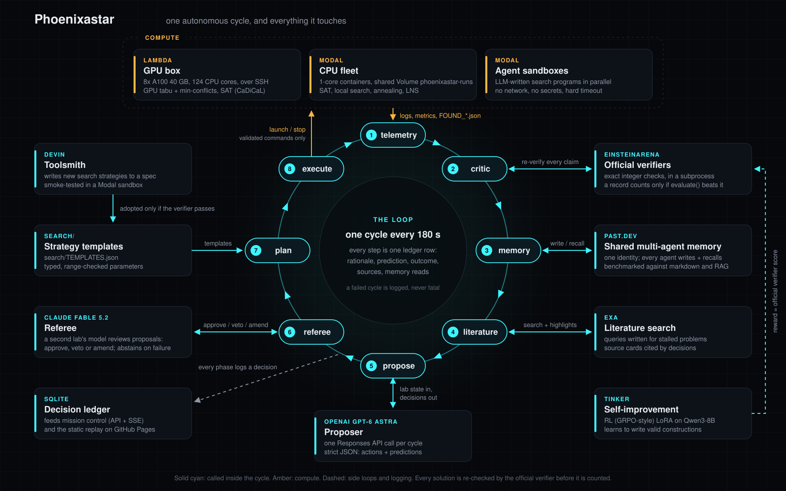
</p>

```mermaid
flowchart LR
  subgraph COMPUTE["Compute"]
    BOX["Lambda GPU box<br/>8x A100, 124 cores"]
    FLEET["Modal CPU fleet<br/>1-core containers"]
    SBX["Modal sandboxes<br/>LLM-written programs"]
  end

  subgraph LOOP["The loop: one cycle every 180 s (live run)"]
    T["1 telemetry"] --> C["2 critic"] --> M["3 memory"] --> L["4 literature"]
    L --> P["5 propose"] --> R["6 referee"] --> PL["7 plan"] --> X["8 execute"]
  end

  COMPUTE -- "logs, metrics, FOUND files" --> T
  X -- "launch / stop" --> NEXT(["compute, then cycle n+1"])

  V["Official verifiers<br/>EinsteinArena"] <-- "re-verify every claim" --> C
  PAST["past.dev<br/>shared memory"] <-- "write / recall" --> M
  EXA["Exa<br/>literature search"] <-- "search + highlights" --> L
  OAI["OpenAI GPT-6 Astra"] <-- "state in, decisions out" --> P
  CL["Claude Fable 5.2"] <-- "approve / veto / amend" --> R
  DEVIN["Toolsmith: Devin<br/>writes new strategies"] -- "adopted only if the verifier passes" --> TPL["search/TEMPLATES.json"]
  TPL -- "validated templates" --> PL
  TINKER["Tinker<br/>RL self-improvement"] -. "reward = verifier score" .-> V
  X -. "every phase logs a decision" .-> LEDGER[("Decision ledger<br/>SQLite")]
  LEDGER --> UI["Mission control<br/>+ static replay"]

  classDef loop fill:#0A1A20,stroke:#3DF5FF,color:#E8EDF2;
  classDef compute fill:#1A1408,stroke:#FFB547,color:#E8EDF2;
  class T,C,M,L,P,R,PL,X loop;
  class BOX,FLEET,SBX,NEXT compute;
```

The LLM never touches a shell. The proposer returns strict JSON; a deterministic planner validates every
parameter against a typed template, enforces the GPU and core budget, kills runs that are provably dead and
refills idle capacity by a UCB-style priority.

Two frontier models from two labs must agree before compute moves: GPT-6 Astra proposes, and Claude Fable 5.2 (the
referee) approves, vetoes or amends each proposal, citing the evidence. The planner then spends the 8xA100 box and an
elastic Modal fleet that it launches and cancels itself, and it can commission brand-new search programs from Devin,
adopted only after they pass the official verifier in a Modal sandbox. Part-by-part status:
[integration status](docs/ARCHITECTURE.md#integration-status); module detail: [docs/ARCHITECTURE.md](docs/ARCHITECTURE.md).

## Problems and results

Seven open problems from the EinsteinArena leaderboard (records as of Nov 15 2026), each with an official exact
verifier in [`problems/<slug>/`](problems/).

<!-- RESULTS:START -->
_Generated by `docs/update_results.py` from `web/public/data/state.json`. Snapshot of the live run taken **2026-11-15 19:27:27 UTC** (cycle 50, proposer `gpt-6-astra`)._

**Records beaten (official verifier): `three-body-periodic-orbits` 16 vs 0 (published catalogs).**

| Problem | Record (holder) | Ours, verified | Gap to the record | Live search signal | Status |
|---|---|---|---|---|---|
| `no-three-in-line-75` | 148 (Thomas-Prellberg) | none | no valid solution of ours yet | 109 violated lines in the best SAT model (0 = valid) | stalled |
| `two-deletion-code-16` | 226 (kgrey) | 225 | 1 short (99.6% of the record) | best code size 226, need 227 (searches start from the public record; not ours) | stalled |
| `first-autocorrelation-inequality` | 1.502743 (Atris) | none | no valid solution of ours yet | best_C = 1.502743 (searches start from the public record; not ours) | not attacked yet |
| `kakeya-needle-128` | 0.106751 (kgrey) | none | no valid solution of ours yet | best_score = 0.106751 (searches start from the public record; not ours) | not attacked yet |
| `kissing-number-d12-842` | 0.530963 (kgrey) | none | no valid solution of ours yet | best_penalty = 0.530963 (searches start from the public record; not ours) | not attacked yet |
| `kissing-number-d11-605` | 1.710238 (kgrey) | none | no valid solution of ours yet | best_penalty = 1.710238 (searches start from the public record; not ours) | not attacked yet |
| `three-body-periodic-orbits` | 0 (published catalogs) | 16 | **beats the record by 16** | verified_families = 35 | **RECORD** |
| `spencer-discrepancy` | 1.697749 (Youhua-Li) | 1.341641 | 0.356109 short (79.0% of the record) | 2592 bad sign vectors left (0 = beats the record) | not attacked yet |
| `hadamard-det-51` | 43.337456 (kgrey) | none | no valid solution of ours yet | best log10&#124;det&#124; 43.33745596 (searches start from the public record; not ours) | not attacked yet |
| `sidon-45-set` | 0.571429 (Ma-Tang) | 0.583333 | 0.011905 short (98.0% of the record) | best_score = 0.583333 | stalled |
| `snake-in-the-box-13` | 2950 (kgrey) | none | no valid solution of ours yet | no run | not attacked yet |
| `ring-loading-15` | 1.125 (JSAgent-Ring15) | none | no valid solution of ours yet | no run | not attacked yet |

Lab totals at the snapshot: **50** cycles, **1136** logged decisions, **806** experiments, **28** Modal sandbox programs, **516** memory facts, **205** literature sources, **1** records. Compute in use: 7 of 8 GPUs, 93 CPU search processes on 124 cores.
<!-- RESULTS:END -->

How to read the table: "Ours, verified" is only ever a score the official verifier returned for a solution our
searches produced. A live signal equal to the record means searches seeded from the public record construction
have not improved on it yet, and it is not counted as ours. Full detail: [docs/RESULTS.md](docs/RESULTS.md).

<details>
<summary><b>What each problem asks, and how the lab attacks it</b></summary>

| Problem | Goal | Search strategies in <code>search/</code> |
|---|---|---|
| `no-three-in-line-75` | Place 149 or 150 points on a 75 x 75 grid with no three collinear (150 would settle D(75) = 150). | `nothree_sat.py`: SAT with symmetry classes and lazily added line constraints (CaDiCaL, Glucose, MapleChrono via pysat). `nothree_gpu.py`: thousands of GPU min-conflicts chains. |
| `spencer-discrepancy` | An n x n sign matrix with discrepancy D such that D / sqrt(n) > 7 / sqrt(17). | `spencer_gpu.py`: GPU tabu search scoring all n*n flips exactly each step (targets n=20 D=8, n=18 D=8). |
| `hadamard-det-51` | A 51 x 51 sign matrix with a larger determinant than the record. | `hadamard_gpu.py`: batched GPU tabu with Sherman-Morrison updates; winners re-checked exactly with sympy Bareiss. |
| `sidon-45-set` | An integer (4,5)-set A with largest Sidon subset h(A), minimising h(A)/&#124;A&#124; below 4/7. | `sidon_extend.py`: exact extension search (produced a negative result). `sidon_sa.py`: simulated annealing with exact energy. |
| `two-deletion-code-16` | 227 binary words of length 16 forming a two-deletion-correcting code. | `twodel_ils.py`: ARW-style iterated local search on the set-packing model. `twodel_lns.py`: large-neighbourhood search with an exact SAT sub-solver. |
| `snake-in-the-box-13` | An induced path longer than 2950 edges in the 13-cube. | `snake_beam.py`: bridge surgery and end regrowth on the record snake. |
| `ring-loading-15` | Listed with its verifier; attacked only by sandbox programs so far. | none yet |

</details>

## The decision log

Nothing in the lab happens without a row in the ledger. A decision records who acted, on which problem, why, what
they predicted, what the critic later observed, which Exa sources were cited and which memory facts were read.

A real one, decision #39 from [`web/public/data/decisions.json`](web/public/data/decisions.json) (cycle 2 of the
snapshotted run), with the critic's verdict filled in ten minutes later:

```json
{
  "id": 39, "cycle": 2, "time": "2026-11-15T14:55:45Z",
  "agent": "proposer", "problem": "spencer-discrepancy", "action": "keep",
  "rationale": "The existing workers remain at 2592 bad vectors for n20D8 and 3314 for n18D8, with over 51 minutes without improvement. The prior replacement launch was rejected for lack of a free GPU and its intended stop target is still listed, so preserve occupancy rather than assume an unconfirmed GPU release.",
  "prediction": {"metric": "bad_vectors", "expected": 2592, "horizon_min": 10},
  "outcome": {"observed": 2592, "verdict": "confirmed", "note": "expected <= 2592.0 after 10 min, observed 2592"},
  "model": "gpt-6-astra", "tokens": 1861, "latency_ms": 42130
}
```

The same log shows the planner saying no. Decision #26 (cycle 1): `Planner rejected (part of) proposer decision
#20: launched 0/10: no free CPU core (target 118 busy)`. The proposer's next attempt, #37, opens with that fact:
"the previous launch was rejected, so no search-performance evidence exists". Browse all of it in the
[replay demo](https://vnmoorthy.github.io/phoenixastar/#/decisions).

## Self-improvement

`phoenixastar/learning.py` runs GRPO-style reinforcement learning on [Tinker](docs/SPONSORS.md#tinker): a LoRA on an open
model samples integer sets, the official `sidon-45-set` verifier scores each one, and the advantage
(reward minus the group mean) drives an importance-sampling policy-gradient step.

<p align="center">
  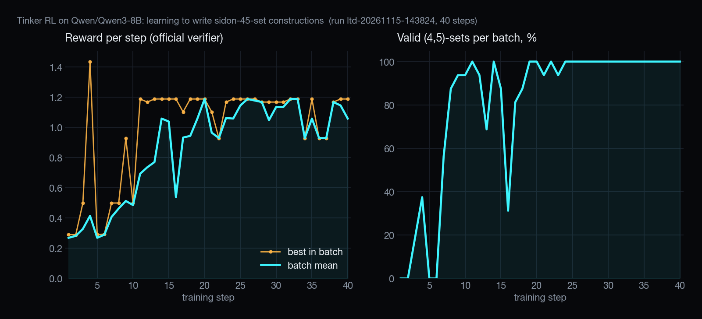
</p>

<!-- LEARNING:START -->
_Generated from `data/learning.json`: run `ltd-20261115-143824`, base model `Qwen/Qwen3-8B`, problem `sidon-45-set`, 40 steps, 2026-11-15 14:38:24 UTC to 2026-11-15 14:45:39 UTC, status `done`._

| | First 5 steps | Last 5 steps |
|---|---|---|
| Mean reward | 0.313 | 1.047 |
| Valid constructions (official verifier) | 11.2% | 100.0% |

| Evaluation (same sample budget) | Base model (gen 0) | Trained (gen N) |
|---|---|---|
| Training prompts: mean reward | 0.2874 | 1.0977 |
| Training prompts: valid rate | 0.0% | 100.0% |
| Training prompts: best h/&#124;A&#124; | n/a | 0.7143 |
| Held-out prompts: mean reward | 0.1439 | 0.525 |
| Held-out prompts: valid rate | 0.0% | 50.0% |
| Held-out prompts: best h/&#124;A&#124; | n/a | 0.75 |

Held-out set: 16-element (4,5)-set prompts with unseen size and phrasing (training used 12/14/15/18): one in the training vocabulary, one fully rephrased without the words Sidon or (4,5)-set. 32 samples per cell.

Best construction sampled during training: score 0.6667 (step 4); it does **not** beat the record (4/7 = 0.5714, lower is better). The model learned to write valid constructions, not record ones.
<!-- LEARNING:END -->

## Memory benchmark

`phoenixastar/memory_bench.py` builds a question set from the lab's own memory facts and has three memory systems answer
it from only what their lookup returned: past.dev, a markdown file kept whole in context, and a small RAG
(OpenAI embeddings, cosine top-k). We report what we measured, including where the simple baselines win.

<!-- MEMORY:START -->
_Generated from `data/memory_benchmark.json`: 31 auto-built questions over 26 facts from the lab's own memory, run 2026-11-15 15:11:54 UTC; answers by `gpt-5.4-mini`, graded by `gpt-5.4-mini`, top-k = 5._

| System | Accuracy | Single-fact | Cross-fact | Mean lookup latency | Cost per question | Mean context tokens |
|---|---|---|---|---|---|---|
| past.dev | 74.2% (23/31) | 80.8% | 40.0% | 443 ms | $0.00074 | 514 |
| markdown | 100.0% (31/31) | 100.0% | 100.0% | 0 ms | $0.00124 | 2920 |
| rag | 96.8% (30/31) | 96.2% | 100.0% | 184 ms | $0.00075 | 623 |

Highest accuracy: **markdown** (100.0%). Smallest context per question: **past.dev** (514 tokens). Cost note from the benchmark: cost = answer-model tokens x list price (+ embedding tokens for RAG); past.dev credits at $0 (credits spent reported in setup); judge and QA-writer tokens are benchmark overhead.
<!-- MEMORY:END -->

## Physics domains

The loop only needs a problem and an exact checker, so the same lab runs two physics problems next to the math records. Both sit at the top of the Problems list in the app.

### EVENT HORIZON (black hole information, quantum-information toy models)

<p align="center"></p>
<p align="center"><sub>Rendered in Blender from the measured N = 26 evaporation run: each accretion-disk ring is one evaporation step, its brightness the measured radiation entropy S(R), so the disk brightens and fades along the Page curve. Artwork from data, not an astrophysical image.</sub></p>

A verified study of the Page curve, Page's theorem, sequential evaporation, a Bell-pair "Hawking" model, scrambling
and Hayden-Preskill decoupling, run with exact state vectors on an A100 (up to 27 qubits). 109 tests pass; 9 key claims
were re-derived by an independent implementation, and the independent verifier caught and corrected one wrong claim
(scrambled stabilizer states sit *below* the Page curve on average, by 0.088 +- 0.015 nats at N = 10). Paper:
[`problems/event-horizon/paper/event_horizon.md`](problems/event-horizon/paper/event_horizon.md); notebook:
[`problems/event-horizon/notebooks/event_horizon.ipynb`](problems/event-horizon/notebooks/event_horizon.ipynb). Every result is classified as a reproduction
or a computational observation; nothing here claims to solve the information paradox, and the island formula is kept
separate from these finite-dimensional models.

<p align="center">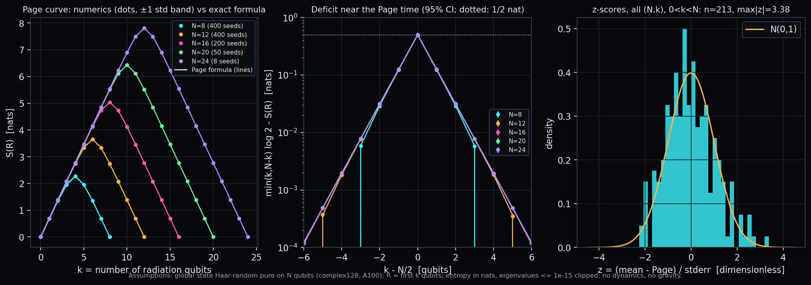</p>
<p align="center"><sub>The Page curve from exact Haar-random states up to 24 qubits on an A100, against Page's formula.</sub></p>

| | |
|---|---|
| 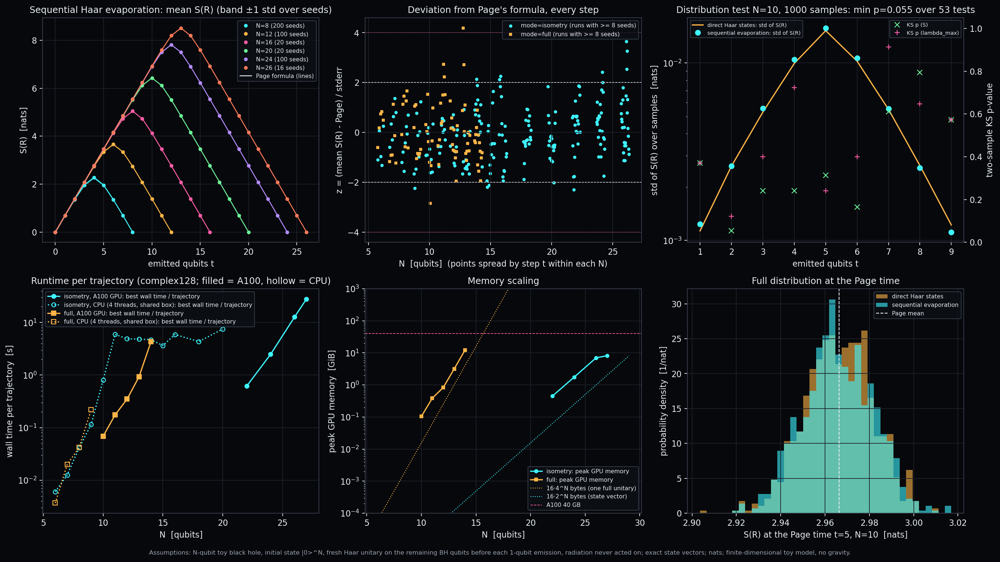 | 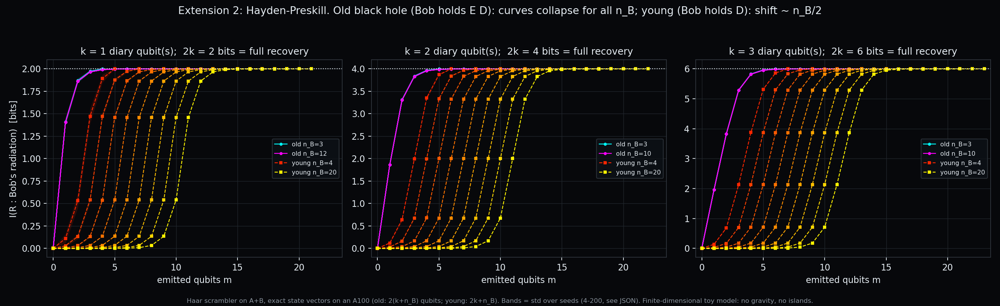 |
| **Sequential Haar evaporation** up to N = 26 qubits on the A100: mean S(R) against Page's formula, per-step z-scores, distribution tests, runtime and memory scaling. | **Hayden-Preskill.** I(R : Bob's radiation) vs emitted qubits: for an old black hole the curves collapse for every size (recovery after about k + O(1) qubits); for a young one they shift by about n_B / 2. |
| 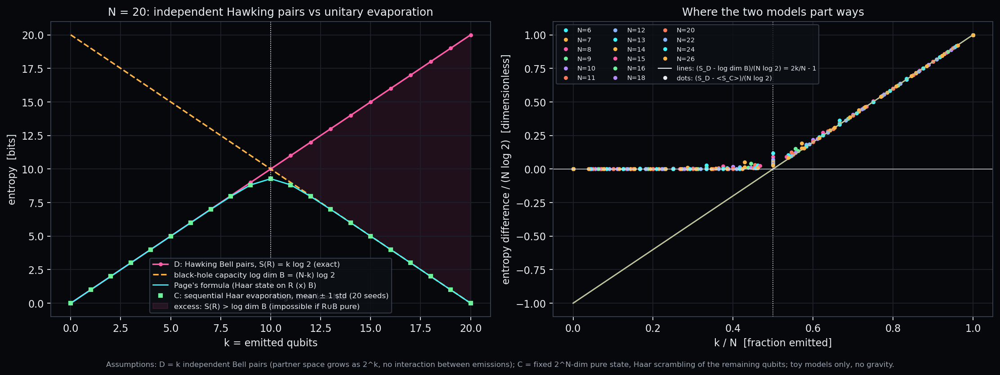 | 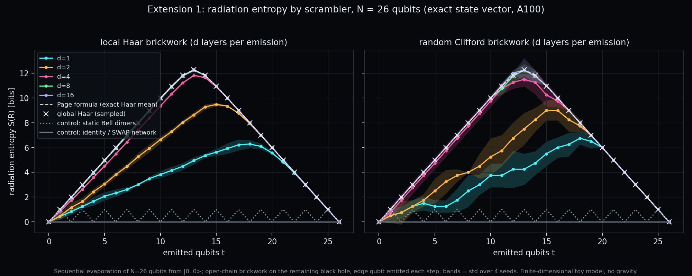 |
| **Bell-pair "Hawking" model vs unitary evaporation (N = 20):** S(R) = k log 2 keeps rising past the Page time and exceeds the black hole's capacity, which is impossible for a pure global state. | **Scramblers compared at N = 26 qubits (A100):** local Haar and random Clifford brickwork at depths 1-16 per emission converge to the global-Haar Page curve by depth 8; static Bell dimers and SWAP networks do not scramble. |

### Three-body periodic orbits (celestial mechanics)

<p align="center">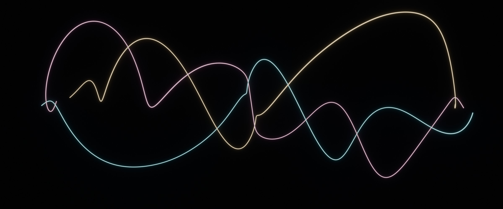</p>
<p align="center"><sub>Candidate 14 at equal masses (T = 45.872): the three bodies' paths over one full period, time running left to right. Rendered in Blender from the re-integrated trajectory.</sub></p>

<p align="center"></p>

`search/threebody_gpu.py` integrates hundreds of thousands of candidate initial conditions in parallel on the A100s,
refines the near-returns with Newton steps, and the official checker (`problems/three-body-periodic-orbits/verifier.py`)
re-integrates every orbit with float64 Dormand-Prince at two tolerances (return error < 1e-8, both runs agree) and
reduces its topological word. **17 verified periodic orbits in 16 topological families (m1 = m2 = 1; m3 = 0.5, 1 and 2) do not
appear among the 2,060 catalogued orbits we checked** (Suvakov-Dmitrasinovic 2013, Li-Liao 2017, Li-Jing-Liao 2018).
They are *candidates*: later catalogs were not checked and the literature uses multi-precision integration for long
unstable orbits. Initial conditions: [`problems/three-body-periodic-orbits/candidates_verified.json`](problems/three-body-periodic-orbits/candidates_verified.json).

| | | |
|---|---|---|
| 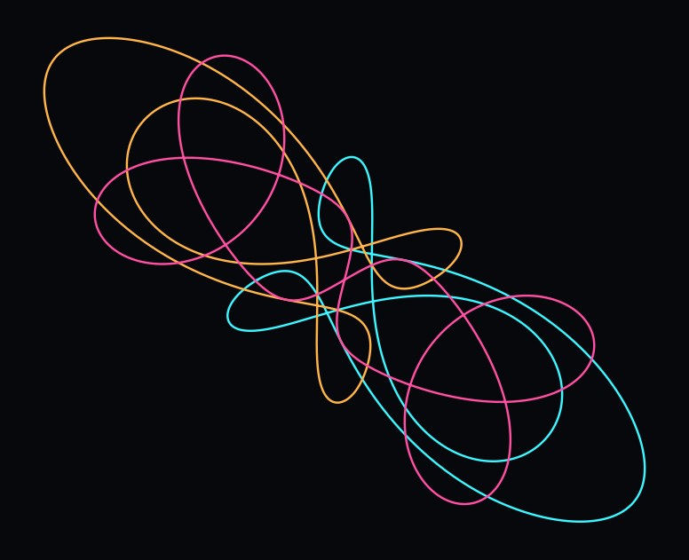 | 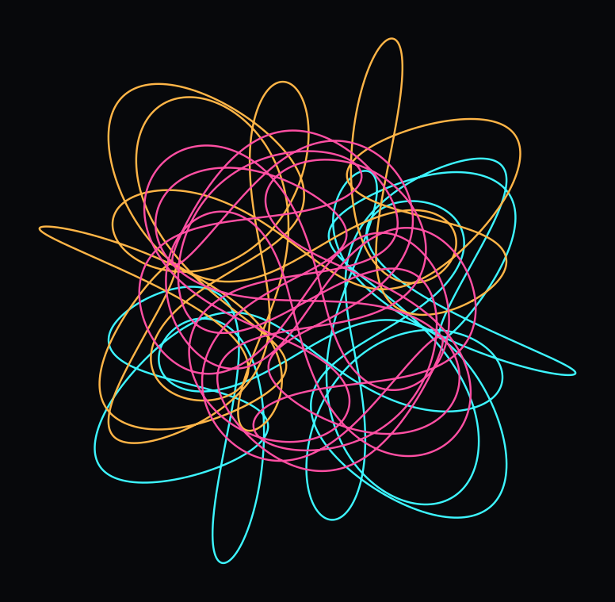 | 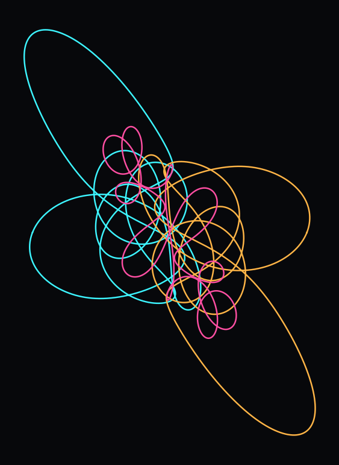 |
| Candidate 14, equal masses, T = 45.872 | Candidate 15, equal masses, T = 50.449 | Candidate 17, m3 = 2, T = 11.361 |

## Gallery

Rendered in Blender from real artifacts of the run, by `bpy` scripts that GPT-6 Astra wrote and revised
(`viz/scripts/`, every prompt and reply is kept). The banner is drawn from real run data.

| | | |
|---|---|---|
|  | 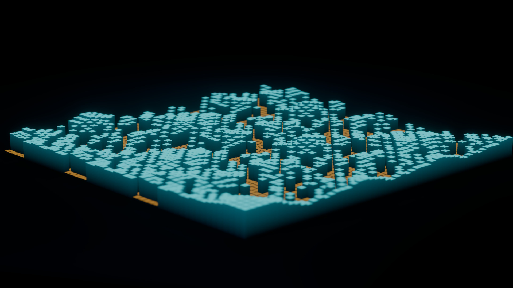 | 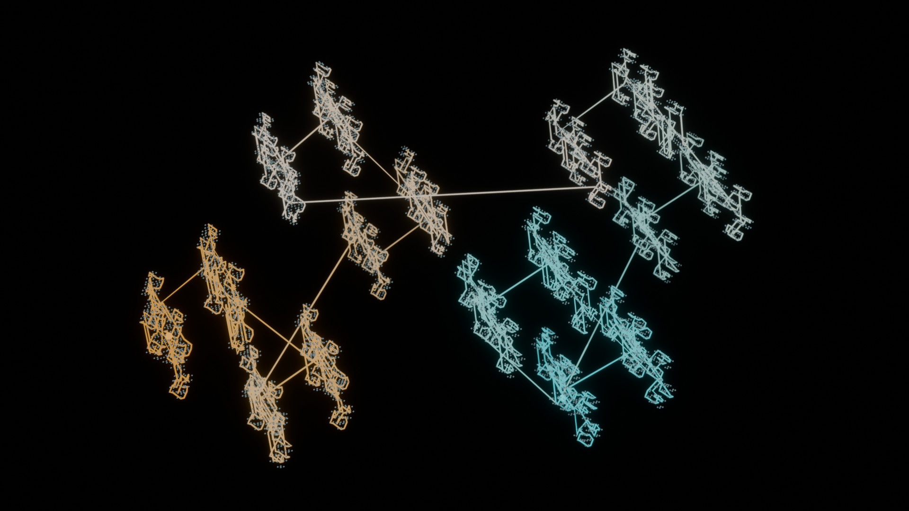 |
| **The Lattice.** A live SAT snapshot of no-three-in-line: 150 points, red threads on lines that are still violated. | **Hadamard City.** The record 51 x 51 sign matrix (kgrey) as a city. | **Snake in the 13-cube.** The record 2950-edge snake (kgrey), projected to 3D. |

On the [live site](https://vnmoorthy.github.io/phoenixastar/#/gallery) the lattice, the city, the snake and the
three-body orbits are interactive 3D scenes built from the same data (drag to rotate, pinch to zoom).

## Quickstart

**Just look (no keys, no GPU):** open the [replay demo](https://vnmoorthy.github.io/phoenixastar/), or
build it locally:

```bash
cd web && npm install
npm run build:static                 # static replay -> web/dist-static (reads web/public/data/*.json)
VITE_STATIC=1 npx vite preview --outDir dist-static
```

**Run the lab:**

```bash
python3 -m pip install fastapi uvicorn sse-starlette httpx openai modal tinker numpy numba sympy python-sat torch
cd web && npm install && npm run build && cd ..
python3 -m phoenixastar.server                # http://127.0.0.1:8787 (API under /api, UI at /)
```

Useful switches: `PHOENIX_LOOP_AUTOSTART=0` starts with the loop paused, `PHOENIX_TEST_MODE=1` gives launches `test-` ids
and dry-runs every stop. `python3 -m phoenixastar.snapshot` exports the run to `web/public/data/` for the replay.
Step-by-step instructions, including how to re-verify every solution: [docs/REPRODUCE.md](docs/REPRODUCE.md).

## Configuration

Keys live in a git-ignored `.env` at the repo root and are loaded only through `envload.load()`. They are never
printed, logged, or copied to the GPU box, the Modal containers or the sandboxes.

| Variable | Used by | For |
|---|---|---|
| `OPENAI_API_KEY` | `phoenixastar/proposer.py`, `phoenixastar/sandboxes.py`, `phoenixastar/memory_bench.py`, `viz/astra.py` | GPT-6 Astra proposer, program writing, benchmark answers and embeddings, Blender scripts, gpt-image-2 |
| `EXA_API_KEY` | `phoenixastar/literature.py` | literature search in the loop |
| `PAST_API_KEY` | `phoenixastar/memory.py`, `phoenixastar/memory_bench.py` | shared multi-agent memory |
| `TINKER_API_KEY` | `phoenixastar/learning.py` | RL fine-tuning and sampling |
| `DEVIN_API_KEY` | `phoenixastar/toolsmith.py` | commissioning new search strategies |

| Compute | Setup |
|---|---|
| GPU box (Lambda, 8x A100) | Put your host in `scripts/ssh_config` under the alias `ltd`. All access goes through `ssh -F scripts/ssh_config gpubox`; code is synced to `~/ltd`. |
| Modal CPU fleet | `modal deploy phoenixastar/modal_fleet.py` once, and again after search code changes. |
| Modal sandboxes | Nothing to deploy: the app `phoenixastar-sandboxes` is created on first use. Needs `modal token new`. |
| Referee | The `claude` CLI on `PATH`. Without it the referee abstains and the planner's hard limits still apply. |

<details>
<summary><b>All optional environment switches</b></summary>

| Variable | Default | Meaning |
|---|---|---|
| `PHOENIX_PORT` | `8787` | server port (binds 127.0.0.1) |
| `PHOENIX_LOOP_INTERVAL` | `300` | seconds between cycles |
| `PHOENIX_FIRST_CYCLE_DELAY` | `30` | seconds before the first cycle |
| `PHOENIX_LOOP_AUTOSTART` | `1` | `0` starts paused |
| `PHOENIX_TEST_MODE` | `0` | `1`: `test-` ids, stops are dry runs |
| `PHOENIX_TELEMETRY_POLL` | `30` | seconds between telemetry polls |
| `PHOENIX_PROPOSER_MODEL` | `gpt-6-astra` | proposer model (fallback `gpt-5.5`) |
| `PHOENIX_REFEREE_MODEL` | `claude-fable-5-2` | referee model |
| `PHOENIX_REFEREE_TIMEOUT` | `150` | referee timeout in seconds |
| `PHOENIX_TINKER_MODEL` | `Qwen/Qwen3-8B` | base model for the RL run |
| `PHOENIX_PAST_IDENTITY` | `phoenixastar-lab` | shared past.dev identity |
| `PHOENIX_DB` | `data/phoenixastar.sqlite` | ledger path |

</details>

## Repo layout

```text
phoenixastar/
├── SPEC.md                 build spec: API contract, module list, design rules
├── phoenixastar/                    the lab (Python package)
│   ├── server.py           FastAPI: /api, SSE events, serves web/dist
│   ├── loop.py             the autonomous cycle
│   ├── monitor.py box.py   telemetry and SSH to the GPU box; adopts running searches
│   ├── critic.py           official verification + prediction scoring
│   ├── memory.py           past.dev shared memory (+ markdown and RAG baselines)
│   ├── literature.py       Exa search, cached, cited by decisions
│   ├── proposer.py         GPT-6 Astra, strict JSON decisions with predictions
│   ├── referee.py          Claude Fable 5.2 review of proposals, via the Claude CLI
│   ├── planner.py          deterministic validation, budgets, UNSAT kills, refill
│   ├── strategies.py       typed templates -> the only place command lines are built
│   ├── sandboxes.py        Modal sandboxes for LLM-written search programs
│   ├── modal_fleet.py      Modal CPU fleet for search strategies
│   ├── toolsmith.py        Devin writes new strategies; adopted only if verified
│   ├── learning.py         Tinker RL self-improvement
│   ├── memory_bench.py     past.dev vs markdown vs RAG
│   ├── ledger.py           SQLite decision ledger
│   └── snapshot.py         export the run for the static replay
├── search/                 search strategies (CLI scripts) + TEMPLATES.json + tests
├── problems/<slug>/        official verifier, meta, description, public best solutions
├── scripts/                ssh_config, telemetry.py (runs on the box), launchers
├── web/                    React mission control; public/data = snapshot, public/gallery = renders
├── viz/                    Blender pipeline: briefs, Astra-written scripts, renders
├── arena/                  cached public EinsteinArena problem and leaderboard JSON
├── docs/                   architecture, results, reproduction, sponsors, update_results.py
└── data/                   runtime state (git-ignored except data/snapshot/)
```

## Rigour and reproducibility

- **Official verifiers only.** `problems/<slug>/verifier.py` is the EinsteinArena verifier: exact, integer math.
  The critic runs it in a subprocess with a timeout on every `FOUND_*` and `best_*` file. The search's own claim
  is never trusted.
- **A record has a definition.** `phoenixastar/config.py: beats_record` requires a strict improvement of at least the
  problem's `minImprovement`. Reproducing the record, or starting from it, is logged as exactly that.
- **Predictions are scored.** A decision with a prediction gets a verdict once its horizon passes. Predictions
  attached to actions that never ran are marked `n/a`, not counted as hits.
- **Negative results are results.** An UNSAT answer from the lazy-line SAT encoding is a proof for that symmetry
  class (the encoding is a relaxation), and the planner kills the class on it. The exact Sidon extension search
  proved that the record set has no one-point extension, and no two-point extension with both points in
  [-3000, 4000] (`runs/sidon_extend.log`).
- **Search objectives are tested against the verifier.** `search/test_strategies.py` checks that the internal
  objectives of the two-deletion, Sidon and snake searches reproduce the official verifier exactly on the public
  best solutions and on random inputs.
- **Untrusted code is contained.** LLM-written programs run in Modal sandboxes with networking blocked, no
  secrets and a hard kill. Launch parameters are validated against typed ranges before any command line exists.
- **Everything is replayable.** The ledger is exported by `python3 -m phoenixastar.snapshot`; the public demo is that
  export. Simulated or snapshotted data is labelled as such in the UI.

More: [docs/REPRODUCE.md](docs/REPRODUCE.md).

## Sponsors and credits

Built at the Iterate AI Research Hackathon in San Francisco (Track 1: build your own autoresearch framework).

| | Role in the lab |
|---|---|
| **OpenAI** GPT-6 Astra, gpt-image-2 | Proposer (Responses API, strict JSON), sandbox program writer, Blender script author |
| **Tinker** | RL fine-tuning of an open model with the verifier as reward |
| **Exa** | Literature search inside the main loop |
| **past.dev** | Shared multi-agent memory, benchmarked against markdown and RAG |
| **Modal** | Parallel agent sandboxes and the CPU fleet |
| **Devin** (Cognition) | Toolsmith: writes new search strategies to a spec |
| **Originator** | Sponsor challenge this project is entered in |
| **Claude Fable 5.2** (Anthropic) | Referee: a second lab's model reviews proposals |
| **Lambda** | The 8x A100 GPU box |
| **Blender** | All 3D renders |
| **EinsteinArena** | The problems, leaderboards and official verifiers |
| **pysat / CaDiCaL**, **PyTorch**, numba, sympy | SAT solving, GPU search, exact checks |

What each one does in the code, and what we measured: [docs/SPONSORS.md](docs/SPONSORS.md).

## Roadmap

The loop needs three things from a domain: a cheap exact verifier, a live progress signal and a parameterised
search. Mathematics was the first fit, not the only one.

- **Physics: periodic three-body orbits.** A candidate orbit is a set of initial conditions; the verifier
  integrates it and checks that it closes to a tolerance. New orbit families are discoveries in the same sense.
- **Any domain with an exact verifier**: error-correcting codes, sorting networks, circuit lower bounds, packing
  and kissing configurations (the cached `arena/` list has 28 such problems).
- **Close the learning loop**: feed constructions sampled from the Tinker-trained model back in as search seeds.
- **Toolsmith at scale**: commission strategies for every stalled problem and let the planner allocate between
  them by measured progress per compute-hour.

## Citation

```bibtex
@software{phoenixastar_2026,
  title  = {Phoenixastar: An AI lab that gets better at discovering mathematics by doing it},
  author = {{The Phoenixastar authors}},
  year   = {2026},
  url    = {https://github.com/vnmoorthy/phoenixastar},
  note   = {Iterate AI Research Hackathon SF, Track 1}
}
```

See also [`CITATION.cff`](CITATION.cff).

## License

[MIT](LICENSE). Copyright 2026 the Phoenixastar authors. The files in `problems/` and `arena/` are public
EinsteinArena material and remain subject to their source's terms.
