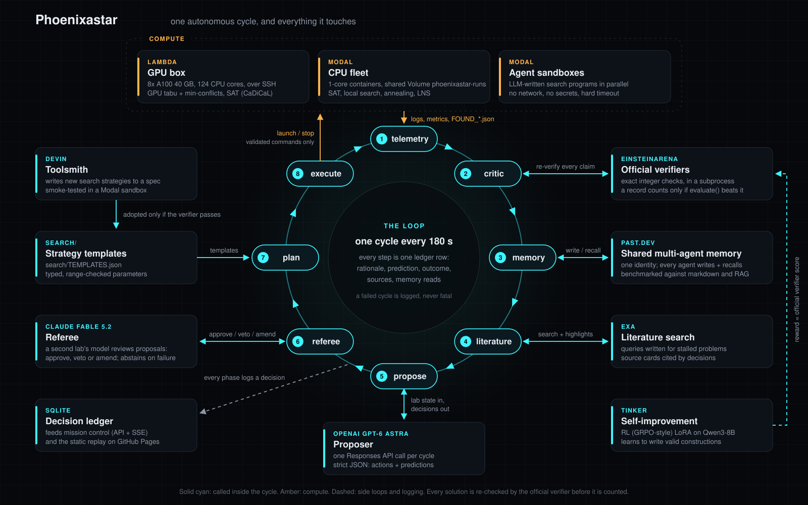

# Architecture

[Back to the README](../README.md) · [Results](RESULTS.md) · [Reproduce](REPRODUCE.md) · [Sponsors](SPONSORS.md)



Phoenixastar is one Python process on a laptop (`python3 -m phoenixastar.server`) that drives remote compute. It
holds no search state itself: searches run on a GPU box and on Modal, write logs and `FOUND_*.json` files, and
the lab reads them back. The source of truth for shapes and contracts is [`SPEC.md`](../SPEC.md).

## Contents

- [The cycle](#the-cycle)
- [Module map](#module-map)
- [Integration status](#integration-status)
- [Compute](#compute)
- [The decision ledger](#the-decision-ledger)
- [Safety rails](#safety-rails)
- [Frontend and replay](#frontend-and-replay)

## The cycle

`phoenixastar/loop.py` runs in a background thread. Default interval: 300 s; the live run uses 180 s (`PHOENIX_LOOP_INTERVAL`). Pause, resume and
run-now are HTTP endpoints. A failing cycle is caught and logged as a decision (`agent: "system"`,
`action: "error"`); it never takes the server down.

| # | Phase | Module | What happens |
|---|---|---|---|
| 1 | telemetry | `monitor.py`, `box.py`, `scripts/telemetry.py` | One SSH call returns a JSON snapshot of the box: per-problem runs, parsed log metrics, `FOUND_*` paths, GPU utilisation, load. Processes that were already running are **adopted** (parsed from their command lines), not restarted. |
| 2 | critic | `critic.py`, `verify_worker.py` | (a) Every `FOUND_*` / `best_*` artifact is re-scored by the official verifier in a subprocess with a timeout. (b) Every past prediction whose horizon has passed gets a verdict, `confirmed` or `refuted`, and the lesson is written to memory. |
| 3 | memory | `memory.py` | Each problem agent writes what it observes, then recalls what the others wrote, from one shared past.dev identity. Reads are recorded per agent, which is what the Memory page draws as links. |
| 4 | literature | `literature.py` | For problems that are stalled (or have no sources yet), a fast model writes queries, Exa returns results with highlights, and they are stored as cards. At most once an hour per problem; cached by query. |
| 5 | propose | `proposer.py` | One OpenAI Responses API call (`gpt-6-astra`, fallback `gpt-5.5`) with strict JSON-schema output: decisions `launch / stop / keep / research / note / sandbox`, each with a rationale, a prediction, cited source ids and the memory facts it used. |
| 6 | referee | `referee.py` | A second lab's model (Claude Fable 5.2, via the local `claude` CLI, run in an empty temp directory) returns `approve / veto / amend` per proposed action. On any failure it abstains. |
| 7 | plan | `planner.py`, `strategies.py` | Deterministic. Validates every proposal against the typed template, enforces free GPUs and the 118-core target, orders stops before launches, adds provable kills (a SAT class proved UNSAT, a target already reached) and refills idle capacity by priority. Anything it refuses is logged as `planner / reject` with the reason. |
| 8 | execute | `planner.execute`, `box.py`, `sandboxes.py` | Launches and stops on the box by explicit pid (after re-checking the pid still runs the expected script), runs sandbox batches, records every step. |

After execute, each problem agent writes the cycle's decisions (and the planner's rejections) to memory, so the
next cycle's proposer reads them.

The planner's priority is UCB-style: gap closed per compute-hour over the last hour, plus an exploration bonus
that shrinks with the number of strategies already launched for the problem, minus a staleness penalty.

## Module map

| File | Responsibility |
|---|---|
| `phoenixastar/server.py` | FastAPI app: the API of SPEC section 4, SSE (`/api/events`), the built frontend, `/gallery`. |
| `phoenixastar/loop.py` | The cycle, phases published over SSE. |
| `phoenixastar/monitor.py` | Polls telemetry, adopts and reconciles strategies, derives per-problem metrics and staleness. |
| `phoenixastar/box.py` | SSH wrapper with timeouts. Never uses `pkill`. |
| `phoenixastar/config.py` | Paths, problem registry (record and holder read from `problems/<slug>/best_solutions.json`), model names, planner knobs, `beats_record`. |
| `phoenixastar/strategies.py` | Templates from `search/TEMPLATES.json`: validation, command-line building, command-line parsing. |
| `phoenixastar/planner.py` | Analysis, priority, provable kills, plan, refill, execute. |
| `phoenixastar/proposer.py` | Builds the compact lab state, calls the model, validates the JSON. |
| `phoenixastar/referee.py` | Cross-model review of proposals. |
| `phoenixastar/critic.py` | Official verification and prediction scoring. |
| `phoenixastar/memory.py` | past.dev ingest and recall, plus the markdown and RAG baselines. |
| `phoenixastar/memory_bench.py` | The memory benchmark. |
| `phoenixastar/literature.py` | Exa search and literature cards. |
| `phoenixastar/sandboxes.py` | LLM-written search programs in parallel Modal sandboxes, verified locally. |
| `phoenixastar/modal_fleet.py` | Modal app `phoenixastar-fleet`: one container per search strategy, logs on the Volume `phoenixastar-runs`. |
| `phoenixastar/toolsmith.py` | Commissions new strategies from Devin; adopts only verified ones. |
| `phoenixastar/learning.py` | Tinker RL run and gen-0 vs gen-N evaluation. |
| `phoenixastar/ledger.py` | SQLite event store. |
| `phoenixastar/views.py`, `phoenixastar/artifacts.py` | API response builders shared by the live server and the snapshot; per-problem artifacts with a `source` of `ours`, `candidate` or `record`. |
| `phoenixastar/snapshot.py` | Static replay export. |
| `phoenixastar/smoke.py` | Read-only smoke test of every GET endpoint. |

## Integration status

Everything below is in the loop's hot path (`phoenixastar/loop.py`, `phoenixastar/planner.py`, `phoenixastar/monitor.py`) and shows up in the
decision log under its own agent name.

| Part | Where in the cycle | Decision log |
|---|---|---|
| telemetry, critic, memory, literature, propose, plan, execute | every cycle | `executor`, `critic`, `memory`, `literature`, `proposer`, `planner` |
| Referee: Claude Fable 5.2 (`phoenixastar/referee.py`) | phase 6, between propose and plan: approve / veto / amend every proposal, citing the evidence; a veto removes the action and marks its prediction n/a. Needs the `claude` CLI on the host running the server; elsewhere it abstains (logged) and the planner's hard limits still apply | `referee` |
| Modal CPU fleet (`phoenixastar/fleet.py`, `phoenixastar/modal_fleet.py`) | the proposer chooses `where: "modal"`; the planner launches / cancels containers (cap `PHOENIX_MODAL_MAX`); the monitor merges the fleet's parsed logs into every telemetry snapshot; the critic verifies FOUND files read from the fleet Volume | `executor / modal_launch`, `executor / modal_stop` |
| Toolsmith: Devin (`phoenixastar/toolsmith.py`) | the proposer may `commission` a new strategy; each cycle the toolsmith polls Devin, smoke-tests delivered code in a Modal sandbox against the official verifier and adopts it as a template only if it passes | `toolsmith / commission`, `testing`, `adopted`, `rejected` |
| Modal sandboxes (`phoenixastar/sandboxes.py`) | proposer `sandbox` action; also from the UI | `sandbox / start_batch`, `sandbox_run` |
| Tinker self-improvement (`phoenixastar/learning.py`) | side loop from the UI or CLI; rewards come from the official verifier | `learning` |
| Memory benchmark (`phoenixastar/memory_bench.py`) | on demand | `memory` |

The server can run on the laptop (it reaches the GPU box over SSH) or on the GPU box itself (`PHOENIX_ON_BOX=1`, the
dashboard reached through an SSH tunnel); during the hackathon it was moved onto the box so the lab kept working while
the laptop was closed.

## Compute

| Where | What runs there | Controlled by |
|---|---|---|
| Lambda GPU box: 8x A100 40 GB, 124 CPU cores, Ubuntu | GPU searches (`spencer_gpu`, `hadamard_gpu`, `nothree_gpu`), and CPU searches (SAT, local search) | `phoenixastar/box.py` over `ssh -F scripts/ssh_config gpubox`; code synced to `~/ltd` |
| Modal CPU fleet (`phoenixastar-fleet`) | CPU strategies as 1-core, 4 GB containers, default 6 h; logs committed to the Volume `phoenixastar-runs` every 20 s; a `telemetry` function parses them with the same parser as the box | `python3 -m phoenixastar.modal_fleet launch | telemetry | cancel` |
| Modal sandboxes (`phoenixastar-sandboxes`) | Short LLM-written programs: networking blocked, no secrets, killed after 110 s inside a 150 s sandbox | `phoenixastar/sandboxes.py`, `phoenixastar/toolsmith.py` |
| The laptop | The server, the loop, the ledger, and every official verification | `python3 -m phoenixastar.server` |

Strategy conventions (SPEC section 2): each strategy is a CLI script in `search/`; it logs one parseable line
per progress step and writes `FOUND_*.json` containing `{"solution": ...}` only after its own exact check. The
lab then verifies again with the official verifier.

| Template | Script | Resource | Problem |
|---|---|---|---|
| `spencer_gpu` | `search/spencer_gpu.py` | GPU | spencer-discrepancy |
| `hadamard_gpu` | `search/hadamard_gpu.py` | GPU | hadamard-det-51 |
| `nothree_gpu` | `search/nothree_gpu.py` | GPU | no-three-in-line-75 |
| `nothree_sat` | `search/nothree_sat.py` | CPU | no-three-in-line-75 |
| `twodel_ils` | `search/twodel_ils.py` | CPU | two-deletion-code-16 |
| `twodel_lns` | `search/twodel_lns.py` | CPU | two-deletion-code-16 |
| `sidon_sa` | `search/sidon_sa.py` | CPU | sidon-45-set |
| `snake_beam` | `search/snake_beam.py` | CPU | snake-in-the-box-13 |

## The decision ledger

`phoenixastar/ledger.py` keeps one SQLite file (`data/phoenixastar.sqlite`) with tables for decisions, telemetry history, memory
facts, literature, artifacts, strategies and learning. A restart keeps history.

A decision row (SPEC section 4):

```text
id, cycle, time,
agent      planner | proposer | critic | executor | literature | memory | sandbox | learning | system
problem, action, params, rationale,
prediction {metric, expected, horizon_min}
outcome    {observed, verdict: confirmed | refuted | pending | n/a, note}
sources    [{id, title, url, published}]      Exa cards this decision cited
memory_reads, memory_writes                   fact ids
model, tokens, latency_ms
```

## Safety rails

- **No LLM text reaches a shell.** Command lines are built only in `phoenixastar/strategies.py` from parameters that passed
  type, range and enum checks.
- **Stops are by pid, re-checked.** A process is stopped only after confirming the pid still runs the expected
  script and, for strategies the lab launched, carries its `PHOENIX_STRATEGY_ID`.
- **Budgets are hard.** The planner cannot launch beyond free GPUs or the CPU target, and caps stops and launches
  per cycle (`MAX_GPU_STOPS_PER_CYCLE = 3`, `MAX_CPU_STOPS_PER_CYCLE = 24`, `MAX_LAUNCHES_PER_CYCLE = 32`).
- **Test mode.** `PHOENIX_TEST_MODE=1` gives launches `test-` ids and turns stops of anything else into logged dry runs.
  The first cycles of the snapshotted run were made in this mode, which is why their predictions are `n/a`.
- **Secrets stay local.** Keys are read from `.env` by `envload.load()`. Nothing copies them to the box, to Modal
  containers or to sandboxes. The snapshot exporter scrubs its output.
- **The referee cannot block the lab.** A missing CLI, a timeout or bad JSON becomes an abstention.

## Frontend and replay

`web/` is React 18, Vite, TypeScript, Tailwind, recharts, framer-motion and three.js. Seven pages: Mission
Control, Problem, Decisions, Memory, Literature, Self-improvement, Gallery. Live mode reads `/api` and the SSE
stream; every number on screen comes from the API.

`python3 -m phoenixastar.snapshot` writes the same API shapes to `web/public/data/*.json`. `npm run build:static` builds a
version that reads those files, uses a hash router, disables every mutating button and shows a "replay of a live
run" banner. That build is what GitHub Pages serves.
