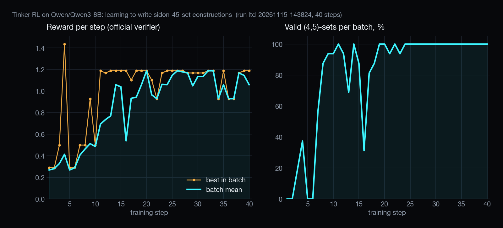

# Results

[Back to the README](../README.md) · [Architecture](ARCHITECTURE.md) · [Reproduce](REPRODUCE.md) · [Sponsors](SPONSORS.md)

Every number in the fenced blocks below is generated by [`update_results.py`](update_results.py) from the run's
data files. To refresh after a new snapshot:

```bash
python3 -m phoenixastar.snapshot            # export the live run to web/public/data/
python3 docs/update_results.py     # rewrite the blocks here and in README.md, redraw the reward curve
```

Rules we hold ourselves to:

- "Ours, verified" is a score returned by the official verifier for a solution our searches produced.
- A solution that equals the record, or a search that starts from the record construction and has not improved
  it, is not a result of ours and is labelled that way.
- A record is claimed only when `phoenixastar/config.py: beats_record` is true: strictly better, by at least the
  problem's `minImprovement`.
- Negative results and baselines that beat a sponsor's product are reported as measured.

## Records and distance to them

<!-- RESULTS:START -->
_Generated by `docs/update_results.py` from `web/public/data/state.json`. Snapshot of the live run taken **2026-11-15 19:06:14 UTC** (cycle 44, proposer `gpt-6-astra`)._

**Records beaten (official verifier): `three-body-periodic-orbits` 7 vs 0 (published catalogs).**

| Problem | Record (holder) | Ours, verified | Gap to the record | Live search signal | Status |
|---|---|---|---|---|---|
| `no-three-in-line-75` | 148 (Thomas-Prellberg) | none | no valid solution of ours yet | 109 violated lines in the best SAT model (0 = valid) | stalled |
| `two-deletion-code-16` | 226 (kgrey) | 225 | 1 short (99.6% of the record) | best code size 226, need 227 (searches start from the public record; not ours) | stalled |
| `first-autocorrelation-inequality` | 1.502743 (Atris) | none | no valid solution of ours yet | best_C = 1.502743 (searches start from the public record; not ours) | not attacked yet |
| `kakeya-needle-128` | 0.106751 (kgrey) | none | no valid solution of ours yet | best_score = 0.106751 (searches start from the public record; not ours) | not attacked yet |
| `kissing-number-d12-842` | 0.530963 (kgrey) | none | no valid solution of ours yet | best_penalty = 0.530963 (searches start from the public record; not ours) | not attacked yet |
| `kissing-number-d11-605` | 1.710238 (kgrey) | none | no valid solution of ours yet | best_penalty = 1.710238 (searches start from the public record; not ours) | not attacked yet |
| `three-body-periodic-orbits` | 0 (published catalogs) | 7 | **beats the record by 7** | verified_families = 35 | **RECORD** |
| `spencer-discrepancy` | 1.697749 (Youhua-Li) | 1.341641 | 0.356109 short (79.0% of the record) | 2592 bad sign vectors left (0 = beats the record) | not attacked yet |
| `hadamard-det-51` | 43.337456 (kgrey) | none | no valid solution of ours yet | best log10&#124;det&#124; 43.33745596 (searches start from the public record; not ours) | not attacked yet |
| `sidon-45-set` | 0.571429 (Ma-Tang) | 0.583333 | 0.011905 short (98.0% of the record) | best_score = 0.583333 | stalled |
| `snake-in-the-box-13` | 2950 (kgrey) | none | no valid solution of ours yet | no run | not attacked yet |
| `ring-loading-15` | 1.125 (JSAgent-Ring15) | none | no valid solution of ours yet | no run | not attacked yet |

Lab totals at the snapshot: **44** cycles, **1007** logged decisions, **764** experiments, **28** Modal sandbox programs, **453** memory facts, **197** literature sources, **1** records. Compute in use: 5 of 8 GPUs, 115 CPU search processes on 124 cores.
<!-- RESULTS:END -->

## Detail

<!-- DETAIL:START -->
### Per-problem detail

- **`no-three-in-line-75`** (No-Three-in-Line (75 × 75 grid)): status `stalled`; 0 GPUs; 57 CPU processes; 103 strategies listed; best unchanged for 56.9 min; by target: diag-149 = 188, mirror-149 = 136, rot180-150 = 109, diag-150 = 210; secondary: nothree_gpu.best_triples = 17, nothree_gpu.best_after_deletion = 14.
- **`two-deletion-code-16`** (Two-Deletion-Correcting Code (length 16)): status `stalled`; 0 GPUs; 22 CPU processes; 98 strategies listed; best unchanged for 235.1 min.
- **`first-autocorrelation-inequality`** (First Autocorrelation Inequality (Upper Bound)): status `idle`; 0 GPUs; 0 CPU processes; 0 strategies listed; best unchanged for 134.4 min.
- **`kakeya-needle-128`** (Discretized Kakeya Needle (n = 128)): status `idle`; 0 GPUs; 0 CPU processes; 0 strategies listed; best unchanged for 132 min.
- **`kissing-number-d12-842`** (Kissing Number in Dimension 12 (n=842)): status `idle`; 0 GPUs; 0 CPU processes; 0 strategies listed; best unchanged for 137.3 min.
- **`kissing-number-d11-605`** (Kissing Number in Dimension 11 (n=605)): status `idle`; 0 GPUs; 0 CPU processes; 0 strategies listed; best unchanged for 111.3 min.
- **`three-body-periodic-orbits`** (New periodic orbits of the planar Newtonian three-body problem): status `record`; 5 GPUs; 5 CPU processes; 5 strategies listed; best unchanged for 0 min.
- **`spencer-discrepancy`** (Spencer Discrepancy Constant): status `idle`; 0 GPUs; 0 CPU processes; 0 strategies listed; best unchanged for 303.8 min; by target: n20D8 = 2592, n18D8 = 3314.
- **`hadamard-det-51`** (Hadamard Maximal Determinant (order 51)): status `idle`; 0 GPUs; 0 CPU processes; 0 strategies listed; best unchanged for 302.1 min.
- **`sidon-45-set`** (Sidon Subsets of (4,5)-Sets): status `stalled`; 0 GPUs; 31 CPU processes; 41 strategies listed; best unchanged for 78.3 min. Known negative result: exact search proved there is no 1-point extension of the Ma-Tang 14-point set and no 2-point extension with both points in [-3000, 4000] (runs/sidon_extend.log).
- **`snake-in-the-box-13`** (Snake-in-the-Box (13-dimensional hypercube)): status `idle`; 0 GPUs; 0 CPU processes; 0 strategies listed.
- **`ring-loading-15`** (Ring Loading Problem (15 pairs)): status `idle`; 0 GPUs; 0 CPU processes; 0 strategies listed.

### Predictions

59 of the 1007 logged decisions carry a falsifiable prediction: 9 confirmed, 12 refuted, 11 pending, 27 n/a (`n/a` = the action was never executed, so the prediction cannot be scored).

### Modal sandbox programs

| Problem | Programs | Valid | Best verified score | Against the record |
|---|---|---|---|---|
| `ring-loading-15` | 2 | 2 | 1.125 | equals it (reproduced, not beaten) |
| `sidon-45-set` | 24 | 24 | 0.571429 | equals it (reproduced, not beaten) |
| `spencer-discrepancy` | 2 | 2 | 1.697749 | equals it (reproduced, not beaten) |

### Toolsmith (Devin) sessions

| Problem | Status | Adopted | Created |
|---|---|---|---|
| `spencer-discrepancy` | working | no | 2026-11-15 16:25:20 UTC |
| `no-three-in-line-75` | rejected | no | 2026-11-15 16:01:56 UTC |
| `snake-in-the-box-13` | rejected | no | 2026-11-15 15:01:17 UTC |
<!-- DETAIL:END -->

## Negative results

These are proofs or exhaustive searches, not failures to find something.

- **Sidon (4,5)-sets.** `search/sidon_extend.py` enumerates, exactly and with no range limit, every integer that
  can be added to the Ma-Tang 14-point record set while keeping its largest Sidon subset at 8. There is none.
  The two-point version was run for both points in [-3000, 4000]: none either. Log: `runs/sidon_extend.log`.
  So the record cannot be improved by extending that set by one point, and a better set has to be structurally
  different.
- **No-three-in-line, per symmetry class.** `search/nothree_sat.py` adds line constraints lazily, so the formula
  it solves is always a relaxation of the real problem. If a solver returns UNSAT for a class, no configuration
  of that size exists in that class, and the planner stops the class. At the snapshot above, no class had been
  proved UNSAT.

## Self-improvement (Tinker)



<!-- LEARNING:START -->
_Generated from `data/learning.json`: run `ltd-20261115-143824`, base model `Qwen/Qwen3-8B`, problem `sidon-45-set`, 40 steps, 2026-11-15 14:38:24 UTC to 2026-11-15 14:45:39 UTC, status `done`._

| | First 5 steps | Last 5 steps |
|---|---|---|
| Mean reward | 0.313 | 1.047 |
| Valid constructions (official verifier) | 11.2% | 100.0% |

| Evaluation (same sample budget) | Base model (gen 0) | Trained (gen N) |
|---|---|---|
| Training prompts: mean reward | 0.2874 | 1.0977 |
| Training prompts: valid rate | 0.0% | 100.0% |
| Training prompts: best h/&#124;A&#124; | n/a | 0.7143 |
| Held-out prompts: mean reward | 0.1439 | 0.525 |
| Held-out prompts: valid rate | 0.0% | 50.0% |
| Held-out prompts: best h/&#124;A&#124; | n/a | 0.75 |

Held-out set: 16-element (4,5)-set prompts with unseen size and phrasing (training used 12/14/15/18): one in the training vocabulary, one fully rephrased without the words Sidon or (4,5)-set. 32 samples per cell.

Best construction sampled during training: score 0.6667 (step 4); it does **not** beat the record (4/7 = 0.5714, lower is better). The model learned to write valid constructions, not record ones.
<!-- LEARNING:END -->

The reward, from `phoenixastar/learning.py`:

```text
unparsable, duplicates, or |A| outside [12, 18]           -> 0
parsed but not a (4,5)-set (official verifier rejects)     -> 0.3 * f^3, f = share of good 4-subsets
valid, official verifier score s = h/|A|                   -> 0.5 + (1 - s) + 4 * max(0, 0.75 - s)
                                                              + 0.03 * min(#3-APs, 10)
                                                              + 2 if s < 4/7 (beats the record)
a small -0.1 penalty when the length differs from the requested |A|
```

What this shows and what it does not: the base model produced no valid construction in the evaluation, and the
trained model does, on training prompts and on held-out prompts with an unseen size and phrasing. The trained
model has not produced a construction that beats the record. The dip around steps 5, 6 and 16 is in the data
and is left in the plot.

## Memory benchmark (past.dev vs markdown vs RAG)

<!-- MEMORY:START -->
_Generated from `data/memory_benchmark.json`: 31 auto-built questions over 26 facts from the lab's own memory, run 2026-11-15 15:11:54 UTC; answers by `gpt-5.4-mini`, graded by `gpt-5.4-mini`, top-k = 5._

| System | Accuracy | Single-fact | Cross-fact | Mean lookup latency | Cost per question | Mean context tokens |
|---|---|---|---|---|---|---|
| past.dev | 74.2% (23/31) | 80.8% | 40.0% | 443 ms | $0.00074 | 514 |
| markdown | 100.0% (31/31) | 100.0% | 100.0% | 0 ms | $0.00124 | 2920 |
| rag | 96.8% (30/31) | 96.2% | 100.0% | 184 ms | $0.00075 | 623 |

Highest accuracy: **markdown** (100.0%). Smallest context per question: **past.dev** (514 tokens). Cost note from the benchmark: cost = answer-model tokens x list price (+ embedding tokens for RAG); past.dev credits at $0 (credits spent reported in setup); judge and QA-writer tokens are benchmark overhead.
<!-- MEMORY:END -->

How to read it: at this size (a few dozen facts, about three thousand tokens) the whole memory fits in context,
so the markdown baseline is hard to beat on accuracy and pays for it in context tokens on every question. The
question the benchmark is built to answer is how that trade moves as the number of facts grows; this run does
not answer it yet. The per-question answers and judge reasons are in `data/memory_benchmark.json` (kept under
`data/snapshot/` in git).
